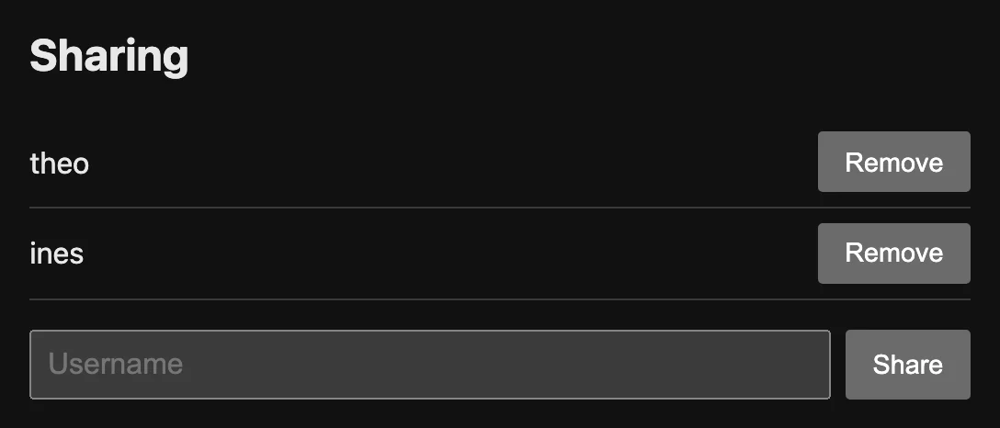

# Prototype: the app redesign

| | |
|---|---|
| Type | Prototype (design mockup and screenshots) |
| Phase | Design |
| Written by | Product designer (in this project: the owner and Claude, with the taste skill) |
| Status | Done (built in PR #32) |
| Date | 2026-10-16 (mockup made 2026-10-10 to 2026-10-11) |
| Data | REAL |

> **What this document is.** A prototype shows how a product will look and work before the real
> code is written. A designer makes it, the team and some users react to it, and only then do
> engineers build. Without a prototype, the first time anyone sees the design is in code, when a
> change is slow and expensive.

## How a real team does it, and what we did

At a software company, a designer usually draws the screens in a design tool such as **Figma**
(a shared drawing tool for screens). Engineers and the product manager comment on the drawing,
and some teams make it clickable for user tests.

This project had no designer and no Figma. Instead:

1. **The design read and the dials.** The plan
   [`docs/plans/app-redesign.md`](../plans/app-redesign.md) (plan PR #30) used the **taste skill**
   (a set of design rules the AI follows) to write one sentence about the product's feel ("calm,
   restrained ... system sans + system light/dark") and three "dials": design variance 4, motion
   3, density 5. The owner approved the read.
2. **An audit.** Screenshots of every page before the redesign, light and dark, at 1280 and 390
   pixels wide (kept outside git, for review only).
3. **An HTML mockup instead of a drawing.** A single static HTML file:
   [`docs/plans/app-redesign-mockup.html`](../plans/app-redesign-mockup.html). Open it in a browser.
4. **The build.** PR #32 built it. The landing page (PR #29) and the login and sign-up pages
   (PR #31) came first and set the shared tokens.

## The mockup

| | |
|---|---|
| File | [`docs/plans/app-redesign-mockup.html`](../plans/app-redesign-mockup.html) |
| Shows | The list page "Home" (owner view, the steps of one to-do open), the same list in the manual order, and the edit page. |
| Data | Invented sample to-dos. |
| Sizes | Built for 1280, 390 and 320 pixel wide windows. Make the window narrow to see the phone layout. |
| Light and dark | Follows the system setting. Switch your system to see both. |
| Rules | No JavaScript and no request to other sites, like the real app. It uses the real row markup from `main` after PR #28. |

Why HTML and not a picture? It uses the **same CSS tokens** (named colors and sizes) as the real
app, so what the owner approved is what was built. It also tests real things a picture cannot:
text wrapping, a narrow screen, dark mode, and keyboard focus.

## What the built app looks like

These are **real screenshots** of the app, with invented data, taken by `make landing-shots`
(`scripts/landing_shots.py`: a scratch database and a free port, never the owner's data). The
landing page uses them too. Each has a light and a dark version in
[`todos/static/todos/landing/`](../../todos/static/todos/landing/).

**A list:** the menu of lists, the add form, search and sort, and two to-dos with a priority, a
due date and a tag.

**Steps inside a to-do:** 2 of 5 done, done steps crossed out, and a field for one more step.

**Sharing, seen by the owner:** two members, each with a Remove button, and a field to share with
one more username.

The other pictures in that folder: `find` (filter and sort), `order` (manual order with handles
and Move buttons), `share-member` (the member's view) and `compare` (one list in light and dark).

## What the owner decided on the mockup

From "Decided by the person" (2026-10-11) in the plan:

| Question | Decision |
|---|---|
| Secondary buttons | One gray-edge look everywhere, also on the landing and login pages. |
| Phones | Row buttons on their own line, at least 44 px tall under a finger. The row's Delete is quiet gray, red on hover and focus. |
| Labels | Visible labels above "New to-do", search, "Username" and "New step"; no colon after a label. |
| Screenshots | The screenshot script goes in the repo, as `make landing-shots`. |

## What the prototype did not cover

- Real people did not try the mockup. A usability test is described (simulated) in
  [UX test plan and findings](ux-test-plan-and-findings.md).
- Screen-reader names and focus after errors came later, in the accessibility pass (PR #45).
- The skill itself says it is not made for dense product UI, so the plan used only its typography,
  color, corner, state, form, dark mode and redesign-audit rules, not its landing-page rules.

## Related documents

- [UX test plan and findings](ux-test-plan-and-findings.md)
- [Design doc](design-doc.md), section 8 "Frontend"
- [Product requirements](../product/prd.md)
- Plans: [`app-redesign.md`](../plans/app-redesign.md), [`accessibility-pass.md`](../plans/accessibility-pass.md), [`dark-mode.md`](../plans/dark-mode.md)
